# Bitácora de Proceso - Frontend MoviCab Express

Documento de seguimiento paso a paso del desarrollo del frontend de **MoviCab Express** en Angular 22 (signals, zoneless, standalone) con PrimeNG 22 y Tailwind CSS 4, siguiendo la guía técnica y la convención de commits por cada ISS terminado.

---

## Información del Proyecto

| Dato | Valor |
|---|---|
| **Frontend** | `front-movicab-express` |
| **Backend** | `movicab-express` (http://localhost:4000/api) |
| **Stack** | Angular 22, PrimeNG 22 (Aura), Tailwind CSS 4 |
| **Carpeta de Evidencias** | `docs/evidencias/` |
| **Convención de Capturas** | `ISS-XX_paso_descripcion.png` |

---

## ISS-00 — Requisitos previos

- **Fecha:** 2026-10-27
- **Estado:** ✅ Completado
- **Objetivo:** Verificar entorno de ejecución, versiones requeridas y disponibilidad del backend sin escribir código en Angular.

### Sub-ítems y Evidencias:

#### Paso 0.1 — Comprobación de versiones de entorno
Se validó que Node.js cumpla con `>= 22.22.3` / `24.x`, NPM y Angular CLI 22.
- **Node.js:** `v22.23.1`
- **NPM:** `10.9.8` / `11.19.1`
- **Angular CLI:** `22.2.3`

```bash
node -v && npm -v
./node_modules/.bin/ng version
```


---

#### Paso 0.2 — Verificación de disponibilidad del backend
El backend Express se encuentra escuchando en el puerto 4000. Al consultar endpoints protegidos sin token responde `401 Unauthorized`.

```bash
curl -s http://localhost:4000/api/permisos
```


---

#### Paso 0.3 — Autenticación y permisos
Se ejecutó login por POST hacia `/api/sesion/login` obteniendo el `access_token` JWT. Luego se validó el acceso a `/api/permisos` con el token en cabecera `Authorization: Bearer <TOKEN>`.

```bash
curl -s -X POST http://localhost:4000/api/sesion/login \
  -H "Content-Type: application/json" \
  -d '{"identifier":"admin","password":"Admin123!"}'
```


---

## ISS-01 — Bootstrap Angular 22 con CLI, Tailwind y PrimeNG

- **Fecha:** 2026-10-27
- **Estado:** ⏳ En desarrollo (Listos pasos 1.1 al 1.7)
- **Objetivo:** Configurar la base del proyecto Angular 22 integrando Tailwind CSS 4 y PrimeNG 22 con el tema Aura, definiendo capas CSS, proveedores globales y componente de validación interactiva con Signals.

### Sub-ítems y Evidencias:

#### Paso 1.1 — Creación del proyecto con Angular CLI
Proyecto generado con soporte de Tailwind CSS mediante `npx @angular/cli@22 new front-movicab-express --directory .`.

- **Estado:** ✅ Completado


---

#### Paso 1.2 — Instalación y verificación de dependencias
Se completaron las dependencias del stack instalando `@angular/cdk` como peer dependency requerida por PrimeNG 22.

- **Comandos:**
```bash
npm install @angular/cdk
npm ls primeng @primeuix/themes primeicons @angular/cdk --depth=0
```
- **Estado:** ✅ Completado

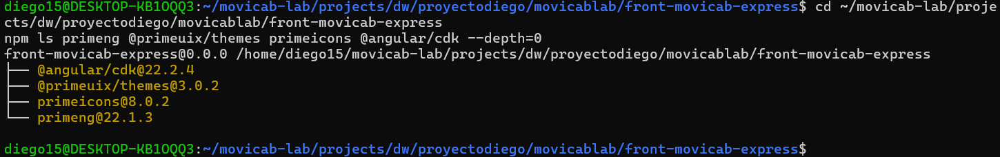

---

#### Paso 1.3 — Configuración de estilos globales y capas CSS
Se estructuró `src/styles.css` con `@layer theme, base, primeng, utilities;` para garantizar que las utilidades de Tailwind tengan prioridad sin recurrir a `!important`.

- **Estado:** ✅ Completado

---

#### Paso 1.4 — Configuración de PrimeNG, tema Aura y entornos
Generación de entornos (`ng generate environments`), configuración de clave de PrimeUI Community en `src/environments/` y configuración de `src/app/app.config.ts` con providers de routing, tema Aura con soporte de dark mode, `MessageService` y `ConfirmationService`.

- **Estado:** ✅ Configurado (pendiente captura en navegador)

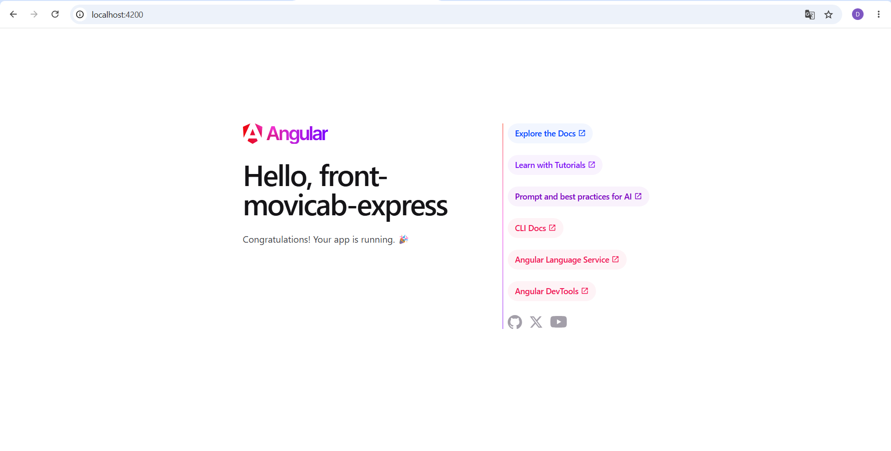

---

#### Paso 1.5 — Pantalla de arranque de ejemplo
Creación del componente interactivo de prueba (`src/app/demo/ejemplo/`) para validar componentes PrimeNG (`p-card`, `p-tag`, `p-inputtext`, `p-button`, `p-message`) y la reactividad con Signals (`signal`, `computed`, `effect`). `App` compone `<app-ejemplo />`.

- **Estado:** ✅ Configurado (pendiente captura en navegador)

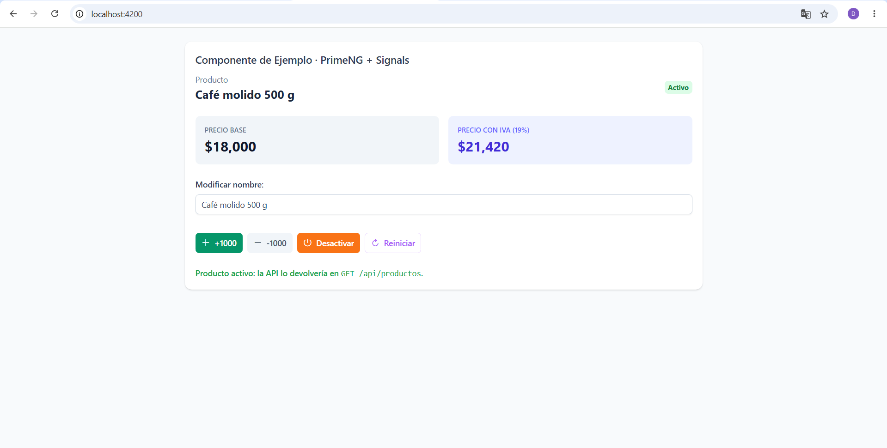

---

#### Paso 1.6 — Configuración de `index.html`
Ajuste de título a `MoviCab Express · Angular 22`, idioma `lang="es"` y clases utilitarias de Tailwind en `<body>`.

- **Estado:** ✅ Completado
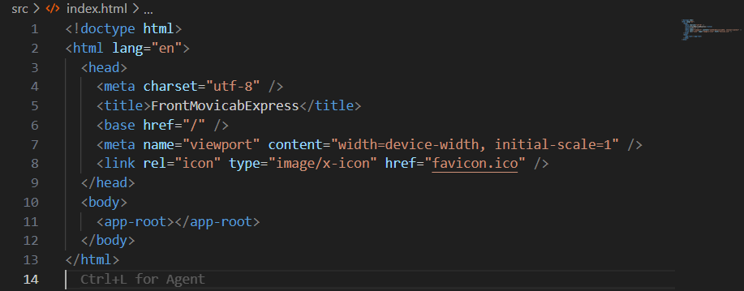
---

#### Paso 1.7 — Presupuesto de compilación en `angular.json`
Ajuste de presupuesto de bundle en `angular.json` a `maximumWarning: 750kB` y `maximumError: 1MB`.

- **Estado:** ✅ Completado
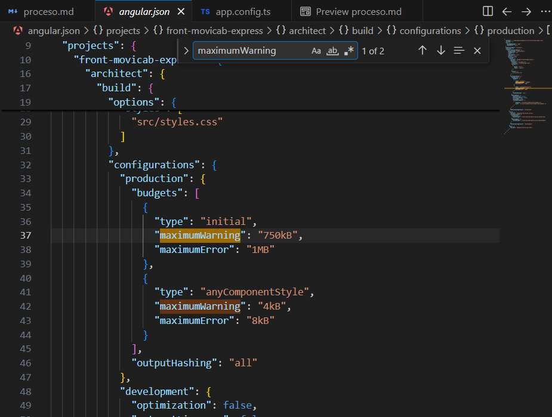
---

#### Paso 1.8 — Primera ejecución y prueba interactiva
Ejecución del servidor de desarrollo con `npm start` y comprobación de interacción con Signals (+1000 al precio).

- **Estado:** ✅ Completado

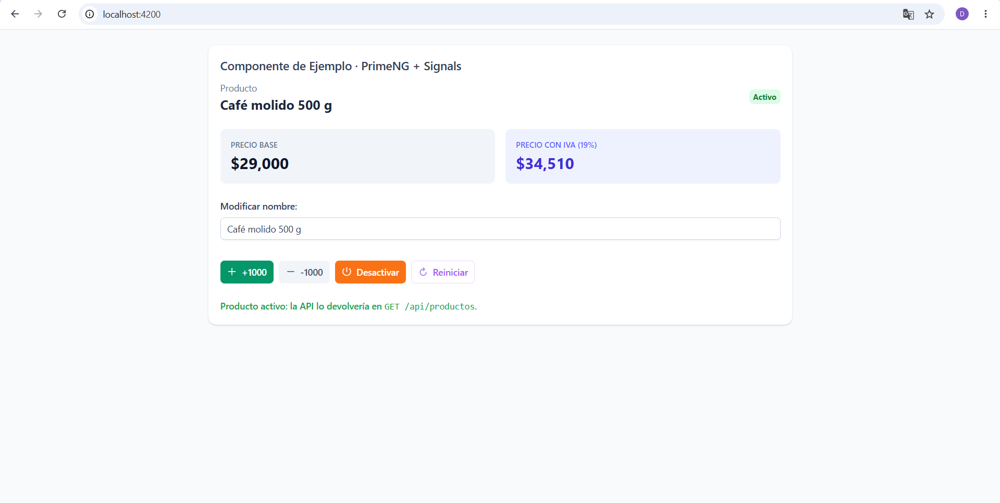

---

#### Verificación final del ISS-01
Validación de compilación limpia y pruebas unitarias (`ng build` y `npm test -- --watch=false`).

- **Estado:** ✅ Completado

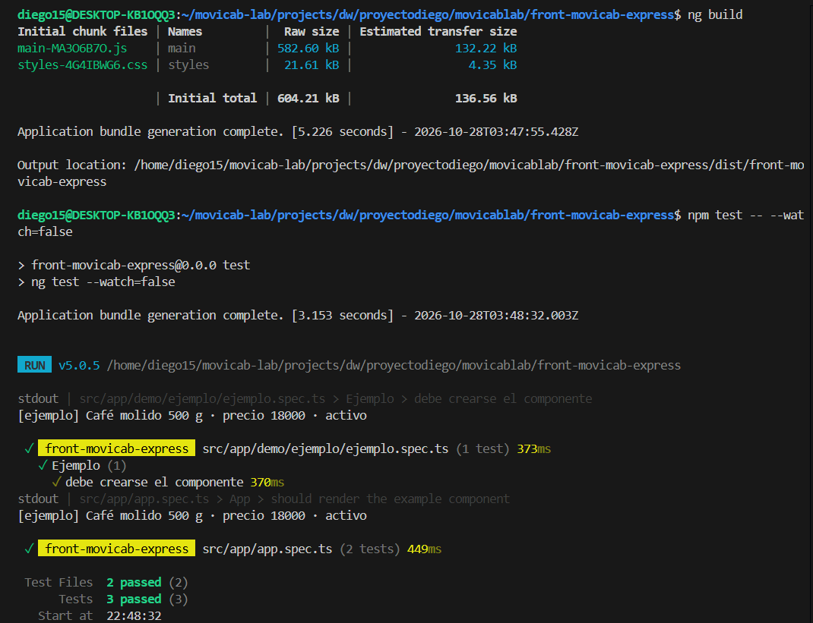

---

### Problemas y soluciones encontrados:
1. **Error de compilación en Paso 1.5 (`NG8004: No pipe found with name 'number'`):**
   - **Causa:** En componentes standalone de Angular, cualquier pipe utilizado en la plantilla debe importarse explícitamente en el componente.
   - **Solución:** Se importó `DecimalPipe` desde `@angular/common` y se añadió al arreglo `imports` de `Ejemplo` en `src/app/demo/ejemplo/ejemplo.ts`.
2. **Advertencia de presupuesto de bundle (`maximum budget 500kB exceeded`):**
   - **Causa:** El bundle inicial con PrimeNG y Tailwind ronda los 604 kB, superando el aviso inicial por defecto de 500 kB.
   - **Solución:** Se ajustó en `angular.json` el `maximumWarning` a `750kB` (Paso 1.7), logrando compilación limpia con código 0 y sin advertencias.

---

---

## ISS-01A — Esqueleto Header, Aside, contenido y Footer

**Rama:** ront-movicab-express | **Fecha:** 2026-10-27

---

#### Paso A.1 — Generar los componentes de layout
Se generaron los tres componentes standalone en src/app/layout/ usando Angular CLI.

- **Comandos:**

`bash
ng generate component layout/header --inline-style=false
ng generate component layout/aside --inline-style=false
ng generate component layout/footer --inline-style=false
`

- **Estado:** Completado

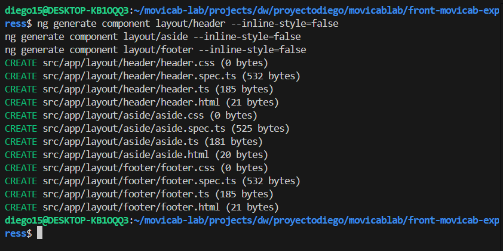

---

#### Paso A.2 — Editar header.ts con propiedad title
Se anadio 	itle = 'MoviCab' a la clase Header para interpolarlo en el template.

- **Archivo:** src/app/layout/header/header.ts
- **Estado:** Completado

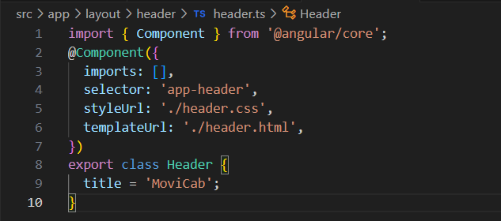
---

#### Paso A.3 — Plantillas HTML de los 3 componentes
Plantillas minimas con Tailwind: header oscuro con titulo, aside lateral con label menu, footer con copyright.

- **Estado:** Completado

---

#### Paso A.4 — Actualizar app.html
Layout flex de 4 regiones: header, aside, router-outlet y footer. Se elimino app-ejemplo.

- **Archivo:** src/app/app.html
- **Estado:** Completado

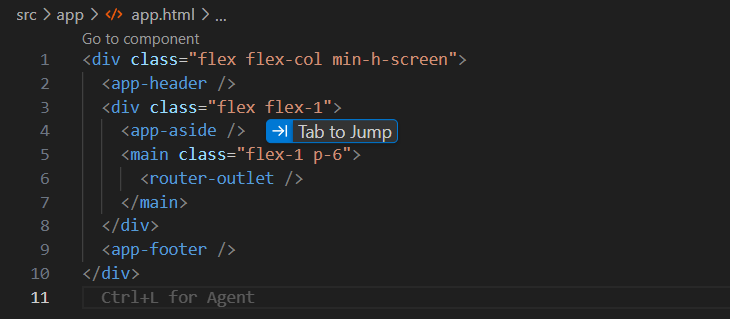
---

#### Paso A.5 — Actualizar app.ts
Se importaron Header, Aside, Footer y RouterOutlet en el decorador de App.

- **Archivo:** src/app/app.ts
- **Estado:** Completado

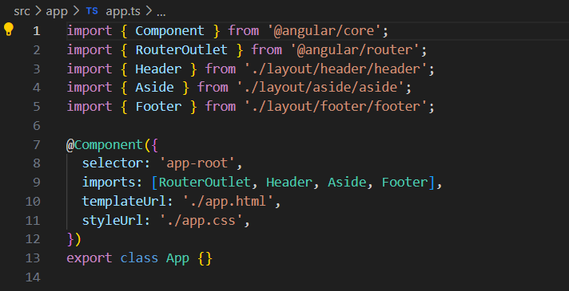
---

#### Verificacion ISS-01A
Servidor en http://localhost:4200 mostrando las 4 regiones. Sin peticiones a /api en Network.

- **Estado:** Completado

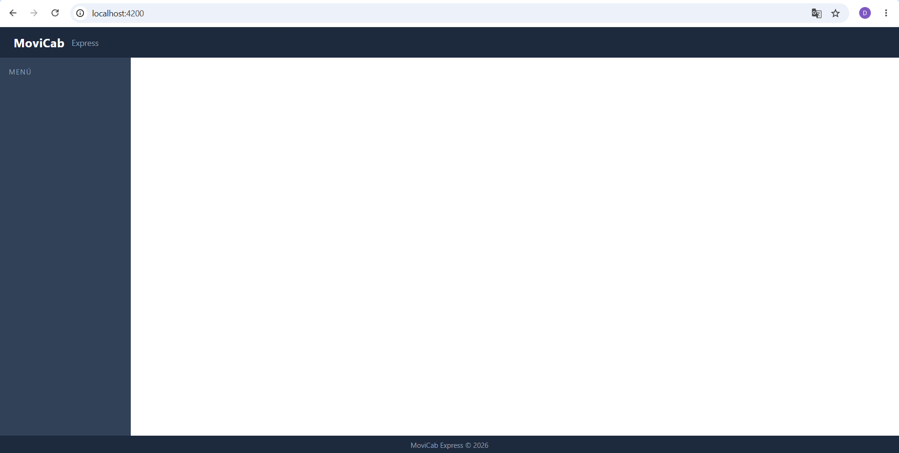

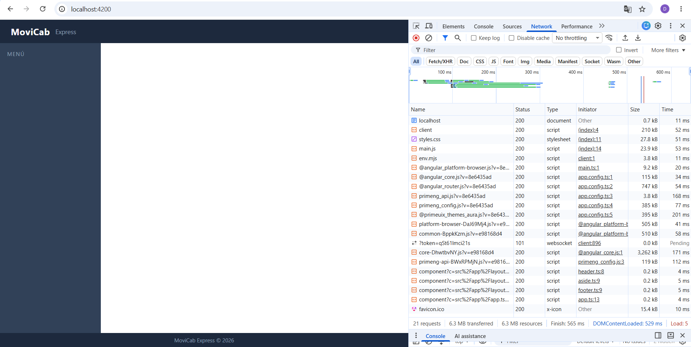

---

## ISS-01B — Menú de navegación lateral responsivo con Drawer

- **Fecha:** 2026-10-27
- **Rama:** `front-movicab-express`
- **Estado:** ✅ Completado
- **Objetivo:** Implementar la navegación lateral con PrimeNG (`p-panelmenu` y `p-drawer`) adaptativa a responsive design, integrando enrutamiento con rutas hijas y lazy loading, además de sincronización de eventos entre Header, Aside y App.

---

### Sub-ítems y Evidencias:

#### Paso B.1 — Utilidad reactiva para Media Query
Se creó el helper reactivo `watchMediaQuery` basado en Signals de Angular y la API nativa `window.matchMedia`, permitiendo escuchar cambios de resolución de pantalla y limpiar listeners al destruir el contexto.

- **Archivo:** `src/app/core/utils/media-query.ts`
- **Estado:** ✅ Completado

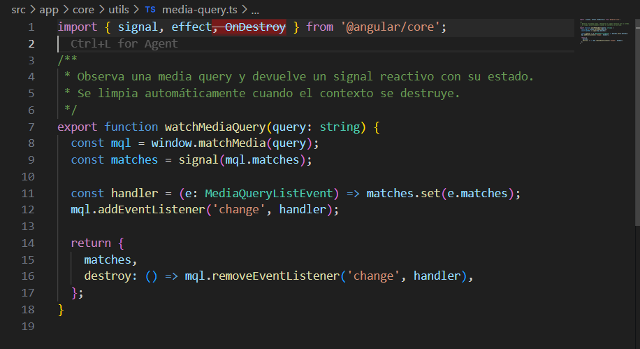

---

#### Paso B.2 — Configuración de rutas y componente placeholder
Configuración de rutas principales en `app.routes.ts` con carga diferida (`loadComponent`) para la ruta `/construir` y redirección inicial por defecto hacia `/construir`.

- **Archivos:** `src/app/app.routes.ts`, `src/app/features/construir/construir.ts`
- **Estado:** ✅ Completado

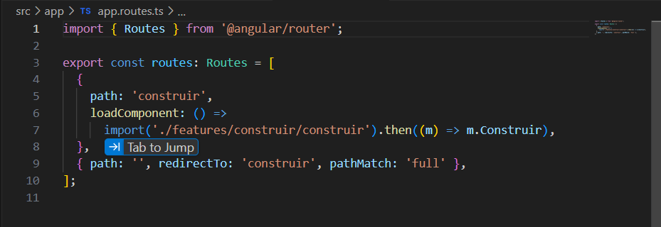

---

#### Paso B.3 — Menú lateral interactivo con PanelMenu en Aside
Configuración del componente `Aside` con `PanelMenu` de PrimeNG. Estructura jerárquica con menú "Operación" y submenú "Construir" con íconos de PrimeIcons, emitiendo el evento `navigated` al hacer clic para cerrar el drawer en móviles.

- **Archivos:** `src/app/layout/aside/aside.ts` y `src/app/layout/aside/aside.html`
- **Estado:** ✅ Completado

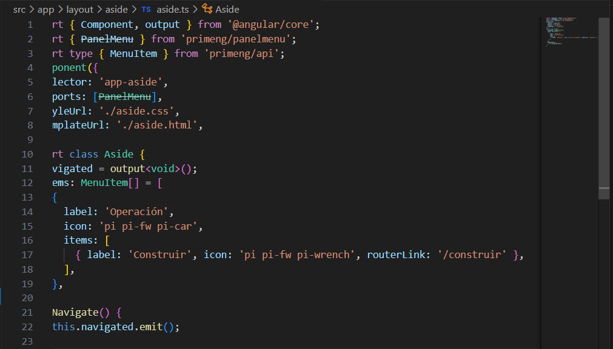

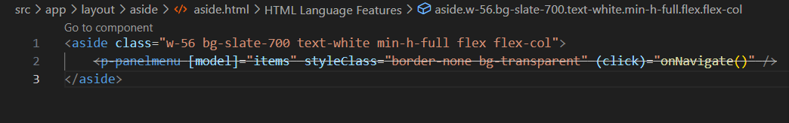

---

#### Paso B.4 — Botón hamburguesa en Header
Incorporación de botón interactivo PrimeNG (`p-button`) con ícono de hamburguesa (`pi-bars`) configurado con la clase `md:hidden` para mostrarse únicamente en resoluciones móviles (< 768px), emitiendo el evento `menuRequested`.

- **Archivos:** `src/app/layout/header/header.ts` y `src/app/layout/header/header.html`
- **Estado:** ✅ Completado

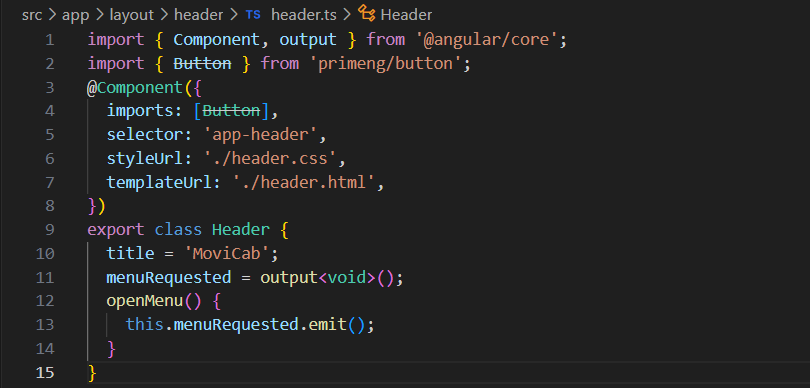

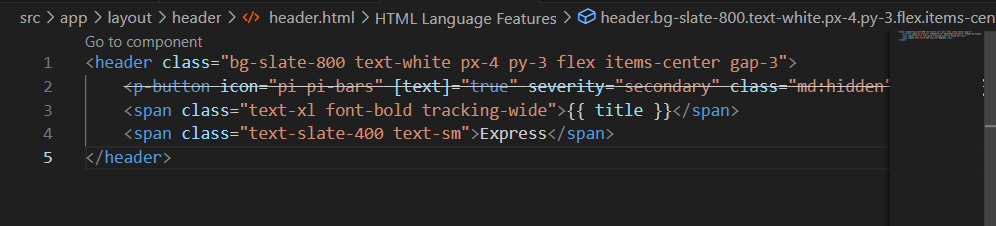

---

#### Paso B.5 — Coordinación de Drawer y layout principal en App
Integración del componente `p-drawer` en `App` con un Signal reactivo `drawerOpen`. En escritorio (>= 768px) el `Aside` permanece fijo en el layout; en pantallas móviles (< 768px), el botón hamburguesa abre el `p-drawer`, y al seleccionar una opción o navegar, el drawer se cierra automáticamente mediante `closeDrawer()`.

- **Archivos:** `src/app/app.ts` y `src/app/app.html`
- **Estado:** ✅ Completado

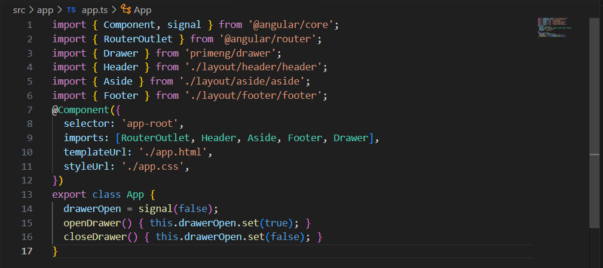

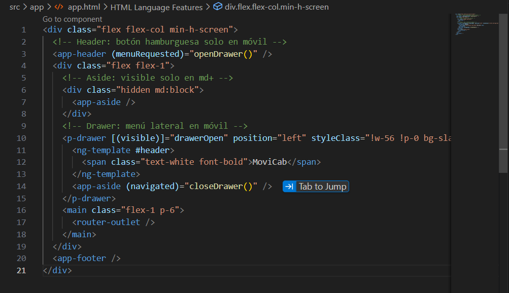

---

#### Verificación en navegador y Responsive Design

1. **Menú en escritorio (1280px):** El `Aside` se renderiza de forma estática en la barra lateral con el `p-panelmenu` colapsable/desplegable.
2. **Drawer en móvil (390px):** El aside lateral se oculta, se muestra el botón ☰ en el header y, al hacer clic, se abre el `p-drawer` con la navegación completa.

- **Estado:** ✅ Completado y Verificado

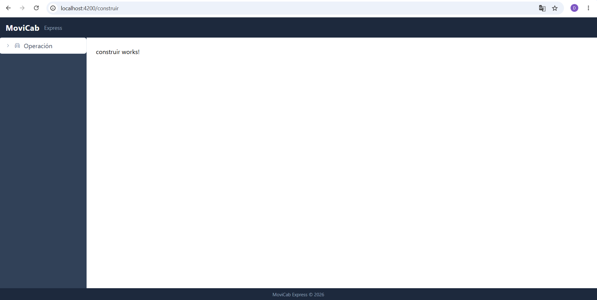

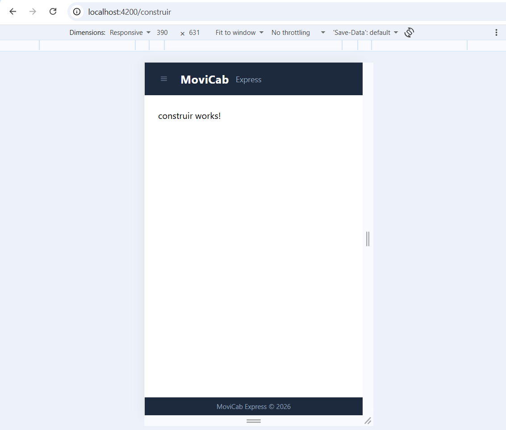

---

### Problemas y soluciones encontrados durante ISS-01B:
1. **Error de compilación en template de Aside (`NG8001: 'p-panelMenu' is not a known element`):**
   - **Causa:** En la versión actual de PrimeNG, el selector del componente es `p-panelmenu` (completamente en minúsculas) y no `p-panelMenu`.
   - **Solución:** Se corrigió la etiqueta en `aside.html` a `<p-panelmenu [model]="items" styleClass="border-none bg-transparent" (click)="onNavigate()" />`.
2. **Advertencias de Angular Compiler (`NG8113: RouterLink / RouterLinkActive is not used within the template`):**
   - **Causa:** PrimeNG maneja internamente la navegación y los enlaces de router a través de las propiedades de cada objeto `MenuItem` (`routerLink: '/construir'`), haciendo redundante la importación directa de las directivas en el componente `Aside`.
   - **Solución:** Se removieron los imports innecesarios de `RouterLink` y `RouterLinkActive` en `aside.ts`, logrando una compilación totalmente limpia.


## ISS-02 — Núcleo: environment, modelos, servicios y shell

- **Fecha:** 2026-10-28
- **Rama:** `front-movicab-express`
- **Estado:** ✅ Completado
- **Objetivo:** Establecer la infraestructura transversal del frontend antes de crear pantallas de negocio: configuración de environments con URL del backend sin barra final, contratos y modelos de dominio en TypeScript, servicios HTTP con envolturas de respuesta de Express, componentes compartidos reutilizables, utilidades de error/notificación y layout Shell persistente con lazy loading.

---

### Sub-ítems y Evidencias:

#### Paso 2.1 — Configuración de Environment
Se fijó `apiUrl: 'http://localhost:4000/api'` en `environment.development.ts` y `environment.ts` asegurando que no tenga barra final para evitar rutas con doble barra (`//`) que generan errores 404 en Express.

- **Archivos:** `src/environments/environment.ts` y `src/environments/environment.development.ts`
- **Estado:** ✅ Completado

---

#### Paso 2.2 — Modelos de Dominio
Creación de 12 interfaces y tipos en `src/app/core/models/` reflejando el contrato exacto de base de datos y negocio del backend (`api.model.ts`, `passenger.model.ts`, `vehicle-type.model.ts`, `company.model.ts`, `driver.model.ts`, `vehicle.model.ts`, `shift.model.ts`, `fare.model.ts`, `trip.model.ts`, `payment.model.ts`, `rating.model.ts`, `settlement.model.ts`).

- **Directorio:** `src/app/core/models/`
- **Estado:** ✅ Completado

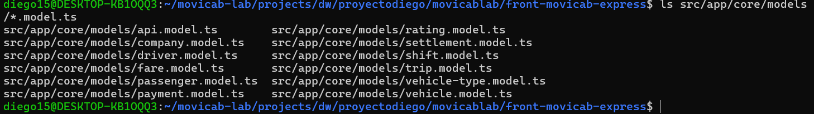

---

#### Paso 2.3 — Servicios HTTP por Feature
Implementación de los 11 servicios HTTP (`PassengerApi`, `VehicleTypeApi`, `CompanyApi`, `DriverApi`, `VehicleApi`, `ShiftApi`, `FareApi`, `TripApi`, `PaymentApi`, `RatingApi`, `SettlementApi`) desenvolviendo las respuestas envoltura del backend (`passengers`, `vehicles`, `fares`, etc.) y suite de pruebas unitarias en `passenger-api.spec.ts` con `HttpTestingController`.

- **Directorio:** `src/app/features/`
- **Estado:** ✅ Completado

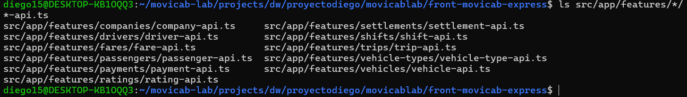

---

#### Paso 2.4 y 2.5 — Utilidades transversales y Componentes compartidos
- **Utilidad `toApiMessage` (`src/app/core/utils/api-error.ts`):** Manejo robusto de errores de red (`status === 0`), mensajes de validación y fallos de backend.
- **Servicio `NotificationService` (`src/app/core/services/notification.ts`):** Capa sobre PrimeNG `MessageService` para estandarizar severidades y duraciones.
- **Componentes compartidos (`src/app/shared/ui/`):**
  - `PageHeader`: Cabecera con título obligatorio y slot para botones de acción.
  - `EmptyState`: Estado vacío visual con icono y mensaje configurable.
  - `StatusTag`: Etiqueta PrimeNG reactiva con `computed` para estados `active` / `inactive`.

- **Estado:** ✅ Completado

---

#### Paso 2.6 y 2.7 — Shell Layout persistente y provisión de HttpClient
- Creación de `Shell` (`src/app/layout/shell/`) que conserva Header, Aside, Drawer, Toast y ConfirmDialog sin remontarlos al navegar.
- `app.routes.ts` actualizado para cargar `Shell` de forma diferida (`loadComponent`), logrando un chunk `shell` independiente.
- `app.config.ts` actualizado con `provideHttpClient()`.

- **Estado:** ✅ Completado

---

#### Paso 2.8 — Verificación y Comprobación de Contrato

1. **Build y Pruebas Unitarias:**
   - `ng build`: Código 0 con chunks lazy independientes (`shell` y `construir`).
   - `ng test --watch=false`: **12 de 12 pruebas unitarias aprobadas en 9 archivos**.

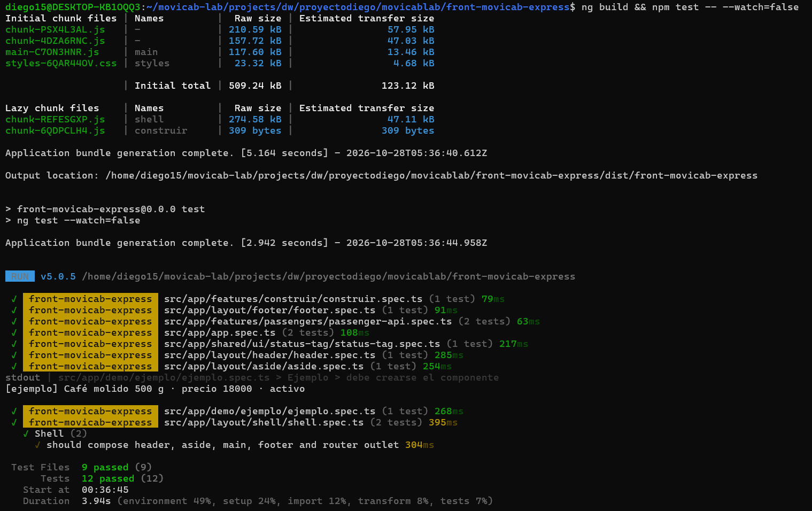

2. **Comprobación de Contrato con Backend:**
   - Verificación de envolturas singulares (`passenger`, `vehicle_type`, `fare`, `trip`, etc.) contra el backend Express en `http://localhost:4000/api`.

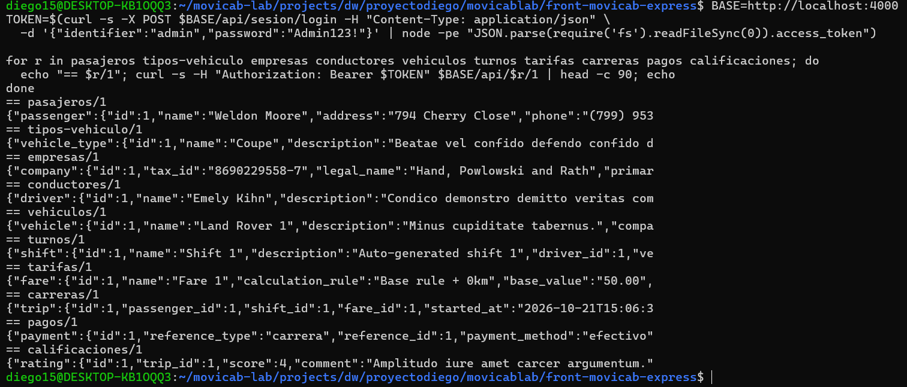

---
## ISS-08 — Bloque A: Sesión mínima (Auth)

- **Fecha:** 2026-10-28
- **Rama:** ront-movicab-express
- **Estado:** ✅ Completado
- **Objetivo:** Implementar la capa de autenticación mínima para que el frontend pueda iniciar sesión, almacenar el token JWT y enviarlo automáticamente en cada petición HTTP al backend, previniendo errores 401 Unauthorized en las rutas de negocio.

---

### Sub-ítems y Evidencias:

#### A.1 — Modelos de Autenticación y Usuario
Definición de los contratos TypeScript para el flujo de autenticación: LoginRequest (credenciales que envía el cliente), LoginResponse (token y expiración que devuelve el backend), JwtPayload (claims decodificados del JWT), UserRole (roles del sistema) y AuthUser (usuario en sesión).

- **Archivos:** src/app/core/auth/auth.model.ts y src/app/core/auth/user.model.ts
- **Estado:** ✅ Completado

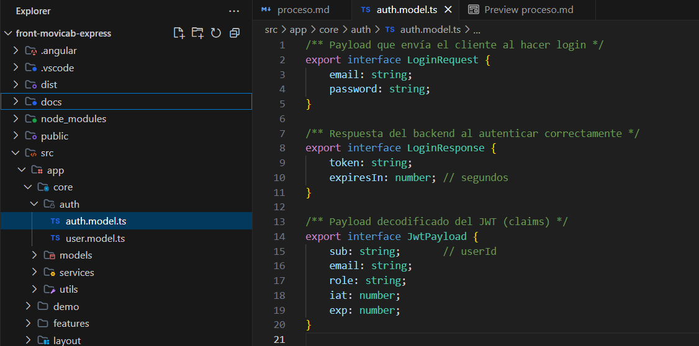

---

#### A.2 — SessionStore
Servicio singleton (providedIn: 'root') que persiste el token JWT y el usuario autenticado en localStorage. Expone señales reactivas de solo lectura (	oken, user, isLoggedIn) para que cualquier componente pueda reaccionar al estado de sesión sin suscripciones manuales.

- **Archivo:** src/app/core/auth/session.store.ts
- **Estado:** ✅ Completado

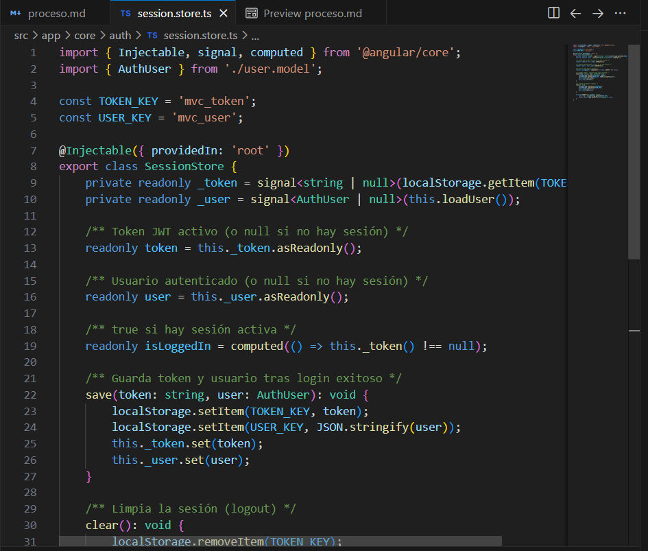

---

#### A.3 — AuthService
Servicio que realiza la petición POST /auth/login al backend, decodifica el payload del JWT con tob() (sin librería externa) y delega el almacenamiento al SessionStore. También expone logout() para limpiar la sesión.

- **Archivo:** src/app/core/auth/auth.service.ts
- **Estado:** ✅ Completado

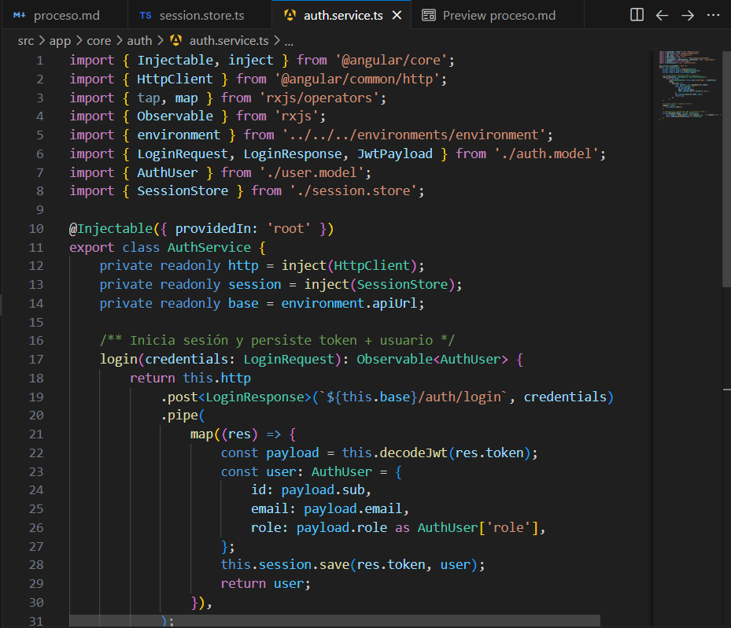

---

#### A.4 — authInterceptor y registro en app.config.ts
Interceptor funcional (HttpInterceptorFn) que inyecta el SessionStore y clona cada petición HTTP saliente agregando el header Authorization: Bearer <token> cuando hay sesión activa. Registrado en pp.config.ts con provideHttpClient(withInterceptors([authInterceptor])).

- **Archivos:** src/app/core/auth/auth.interceptor.ts y src/app/app.config.ts
- **Estado:** ✅ Completado

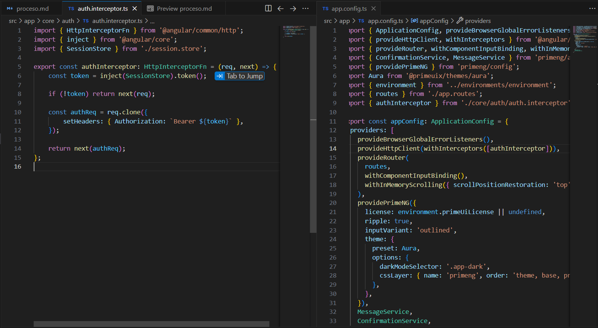

---

#### A.5 — Pantalla de Login
Componente standalone con formulario reactivo usando FormsModule y [(ngModel)] sobre signals. Diseño oscuro con tarjeta centrada. Muestra mensaje de error de PrimeNG cuando el backend responde con credenciales incorrectas. Al autenticarse, redirige a /. Ruta /login registrada como ruta independiente fuera del Shell.

- **Archivos:** src/app/features/login/login.ts, login.html, login.css y src/app/app.routes.ts
- **Estado:** ✅ Completado

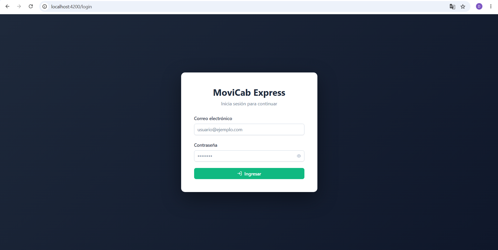

---

### Correcciones aplicadas durante ISS-08:
1. **Rutas mal estructuradas (pp.routes.ts):** La ruta /construir estaba definida fuera del Shell, por lo que el layout nunca envolvía el contenido. Se movió como ruta hija del Shell y se añadió redirect desde '' a construir.
2. **Error NG8002 en p-message:** PrimeNG v19 usa el componente standalone Message (no MessageModule) y el texto va proyectado como contenido, no como propiedad [text]. Se corrigió el import y el template.


## ISS-03 — CRUD de Pasajeros (Fase 1: Listado)

- **Fecha:** 2026-10-28
- **Rama:** \ront-movicab-express\
- **Estado:** 🟡 En progreso (Listado completado)
- **Objetivo:** Conectar el frontend con el endpoint protegido \/api/pasajeros\, asegurando la inyección del token JWT mediante el interceptor y renderizando la lista de pasajeros con PrimeNG \p-table\, paginación, etiquetas de estado y botones de acción.

---

### Sub-ítems y Evidencias:

#### C.1 — Enrutamiento del módulo de Pasajeros
Se configuró la ruta hija diferida (\loadComponent\) en \src/app/app.routes.ts\ apuntando a \PassengerList\, ajustando la redirección por defecto de la aplicación hacia \/passengers\.

- **Archivo modificado:** \src/app/app.routes.ts\
- **Estado:** ✅ Completado

---

#### C.2 — Página de Listado de Pasajeros (PassengerList)
Implementación del componente \PassengerList\ utilizando signals reactivos de Angular, inyección de \PassengerApi\, feedback de estado con \PageHeader\, \EmptyState\ y tabla responsiva \p-table\ de PrimeNG v19.

- **Archivos:** \src/app/features/passengers/passenger-list.ts\ y \passenger-list.html\
- **Estado:** ✅ Completado

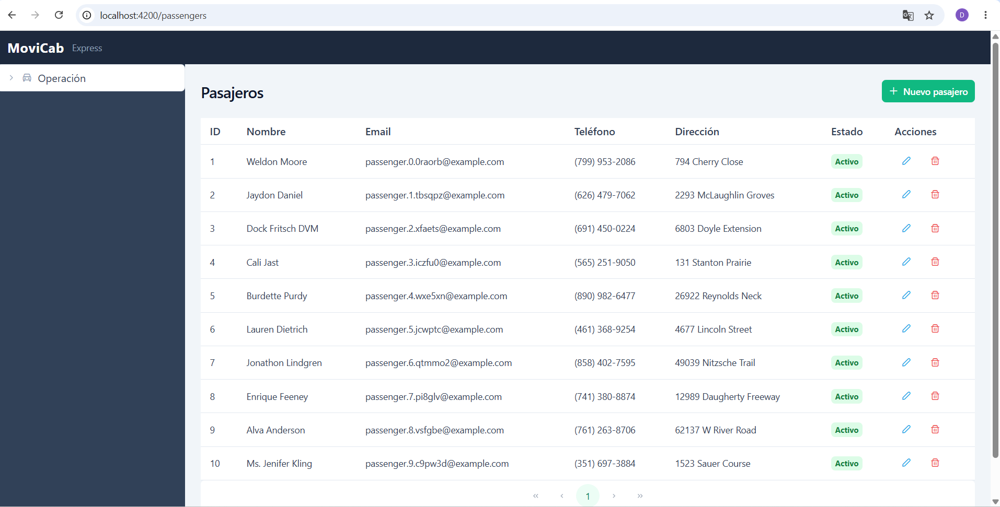

---

### Correcciones y alineación con el Backend en ISS-03 / Auth:
1. **Endpoint y payload de autenticación:** Se alineó el endpoint a \/api/sesion/login\, el campo de entrada a \identifier\ (soporta usuario o correo) y la lectura del token JWT a \ccess_token\.
2. **Métodos de \PassengerApi\:** Se corrigieron los llamados del componente para usar \	his.api.list()\ y \	his.api.remove(id)\.
3. **Sintaxis de plantillas PrimeNG v19:** Se actualizaron los templates de \p-table\ utilizando la directiva moderna \#header\ y \#body\, y se corrigió la propiedad de estado a \p.status === 'active'\.

---

#### C.3 — Formulario de Pasajero (Creación y Edición)
Implementación del componente \PassengerForm\ para dar soporte a las operaciones de creación (\/passengers/new\) y edición (\/passengers/:id/edit\) de pasajeros. 
- Utiliza **Reactive Forms** (\FormGroup\, \Validators\) con validación de obligatoriedad, formato de correo y formato de teléfono.
- En modo edición, detecta el parámetro \:id\ de la URL, consulta al backend mediante \PassengerApi.get(id)\ y precarga los campos mediante \patchValue\.
- Soporte para cambio reactivo de estado con PrimeNG \p-selectbutton\.
- Redirección con feedback de notificación (\NotificationService\) hacia el listado principal tras guardar cambios exitosamente.

- **Archivos:** \src/app/features/passengers/passenger-form.ts\, \passenger-form.html\ y \src/app/app.routes.ts\
- **Estado:** ✅ Completado

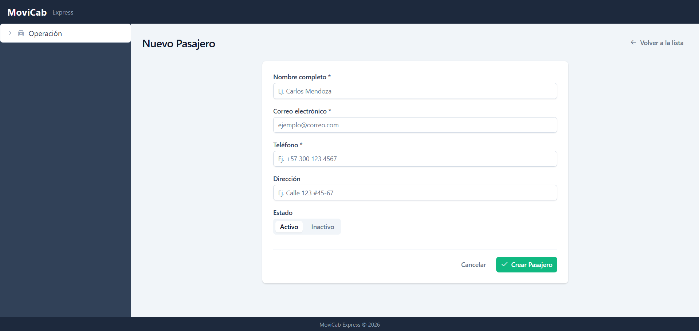

---

#### C.4 — Confirmación Modal y Eliminación de Pasajero
Integración del flujo de eliminación con diálogo de confirmación PrimeNG (`ConfirmationService` y `p-confirmdialog` global provisto en el Shell):
- Al pulsar el botón de eliminación, se despliega un diálogo emergente solicitando la confirmación del operador para prevenir borrados accidentales.
- Al aceptar, se consume el método `PassengerApi.remove(id)` (`DELETE /api/pasajeros/:id`).
- **Manejo de integridad referencial:** Si el pasajero cuenta con registros dependientes en la tabla `trips`, la base de datos bloquea el borrado por clave foránea (`SequelizeForeignKeyConstraintError`); el frontend captura este error y presenta una notificación informativa al operador en lugar de un fallo silencioso.
- Para registros sin dependencias activas, el borrado físico se ejecuta con código 200/204 y refresca reactivamente la tabla de pasajeros.

- **Archivos:** `src/app/features/passengers/passenger-list.ts` y `passenger-list.html`
- **Estado:** ✅ Completado

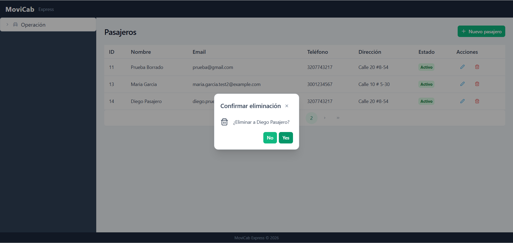

---

### Ajustes de Dominio y Validaciones en ISS-03:
1. **Requisito de contraseña en creación:** El contrato del backend (`POST /api/pasajeros`) exige el campo `password` para crear un pasajero. Se incorporó el control `p-password` en el formulario como campo obligatorio al crear y opcional al editar.
2. **Paginación reactiva:** La tabla gestiona correctamente múltiples páginas (`[rows]="10"`), permitiendo navegar hacia registros nuevos en páginas subsiguientes.
3. **Manejo de expiración de sesión (401):** Se fortaleció el `authInterceptor` para capturar respuestas 401 (token JWT expirado tras 15 minutos), limpiando automáticamente el `SessionStore` y redirigiendo al operador hacia `/login`.

---

## ISS-04 — CRUD de Vehículos y Tipos de Vehículo

- **Fecha:** 2026-10-31
- **Rama:** `front-movicab-express`
- **Estado:** ✅ Completado
- **Objetivo:** Implementar la gestión completa de vehículos (`/vehicles`), integrando la navegación lateral (`Aside`), listado con relaciones foráneas (empresa y tipo de vehículo) mediante PrimeNG `p-table`, formulario reactivo con catálogos foráneos (`forkJoin`) y diálogo modal de confirmación para eliminación.

---

### Sub-ítems y Evidencias:

#### D.1 — Enrutamiento del módulo y navegación lateral en Aside
Configuración de rutas principales con carga diferida (`loadComponent`) para `/vehicles`, `/vehicles/new` y `/vehicles/:id/edit` en `app.routes.ts`. Actualización de `Aside` (`src/app/layout/aside/aside.ts`) con el enlace "Vehículos" (ícono `pi pi-car`) y menú desplegado por defecto.

- **Archivos:** `src/app/app.routes.ts` y `src/app/layout/aside/aside.ts`
- **Estado:** ✅ Completado

---

#### D.2 — Listado de Vehículos con relaciones (VehicleList)
Componente `VehicleList` que consume `VehicleApi.list()` (`GET /api/vehiculos`). Muestra la lista de vehículos con columnas de ID, Nombre/Modelo, Descripción/Placa, Empresa afiliada (`company.legal_name`), Tipo (`vehicle_type.name`), estado coloreado con `p-tag` y botones de acción (editar y eliminar). Maneja estados de carga (`loading`) y estado vacío (`EmptyState`).

- **Archivos:** `src/app/features/vehicles/vehicle-list.ts` y `vehicle-list.html`
- **Estado:** ✅ Completado

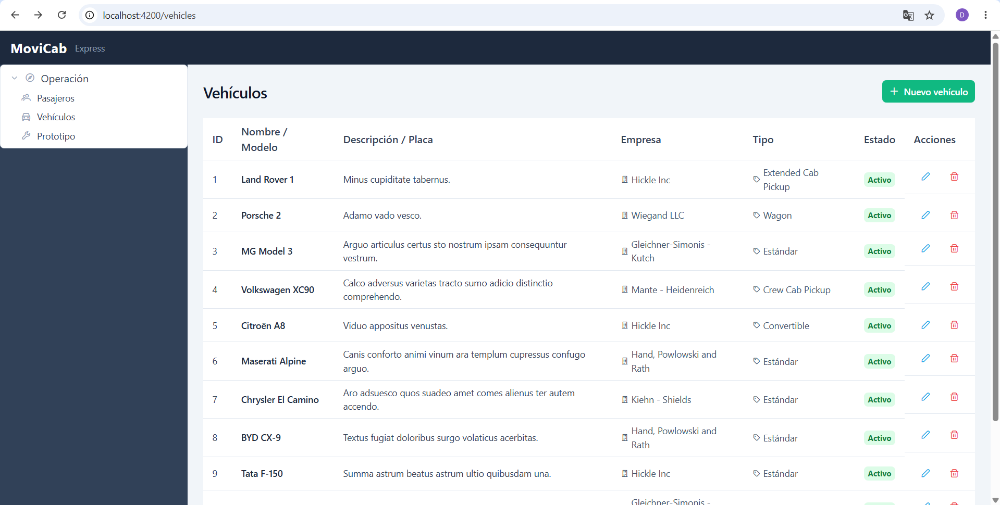

---

#### D.3 — Formulario de Vehículo con catálogos foráneos (VehicleForm)
Implementación de `VehicleForm` con `ReactiveFormsModule` (`FormGroup`, `Validators`). En modo creación o edición:
- Carga concurrente de catálogos mediante `forkJoin({ companies: CompanyApi.list(), types: VehicleTypeApi.list() })`.
- Selectores PrimeNG `p-select` para seleccionar la Empresa obligatoria y el Tipo de Vehículo opcional.
- Detección de parámetro `:id` para precarga automática de datos en modo edición (`api.get(id)` + `patchValue`).
- Control de estado con PrimeNG `p-selectbutton` (Activo / Inactivo).

- **Archivos:** `src/app/features/vehicles/vehicle-form.ts` y `vehicle-form.html`
- **Estado:** ✅ Completado

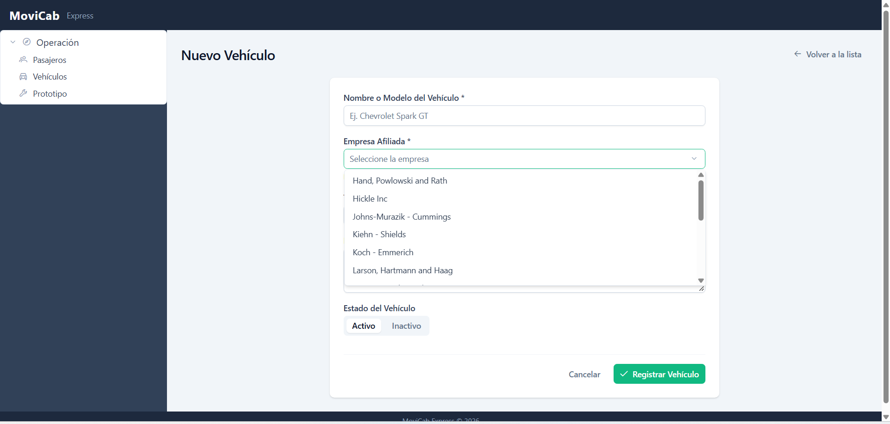

---

#### D.4 — Confirmación Modal y Eliminación de Vehículo
Flujo de eliminación conectado con el servicio global `ConfirmationService` de PrimeNG:
- Despliegue de diálogo modal solicitando confirmación con el nombre del vehículo a eliminar.
- Invocación de `VehicleApi.remove(id)` (`DELETE /api/vehiculos/:id`).
- Manejo de restricciones de integridad referencial: captura de errores de clave foránea y presentación de mensaje descriptivo mediante `NotificationService`.
- Refresco reactivo automático del listado tras la eliminación.

- **Archivos:** `src/app/features/vehicles/vehicle-list.ts` y `vehicle-list.html`
- **Estado:** ✅ Completado

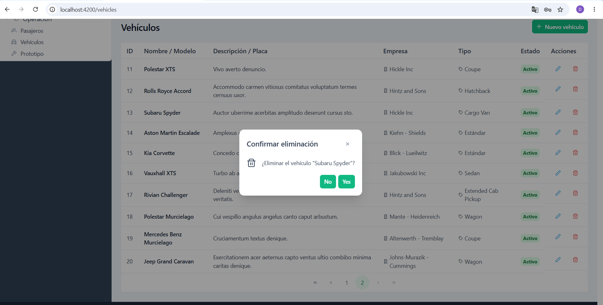

---

## ISS-04B — CRUD de Empresas (Company)

- **Fecha:** 2026-10-31
- **Rama:** `front-movicab-express`
- **Estado:** ✅ Completado
- **Objetivo:** Implementar la gestión completa de empresas afiliadas (`/companies`), integrando la navegación lateral (`Aside`), tabla de empresas con paginación mediante PrimeNG `p-table`, formulario reactivo (`ReactiveFormsModule`) para alta y edición con validación de Razón Social y NIT/identificación fiscal, y modal de confirmación para eliminación.

---

### Sub-ítems y Evidencias:

#### E.1 — Enrutamiento y Listado de Empresas (CompanyList)
Configuración de rutas `/companies`, `/companies/new` y `/companies/:id/edit` en `app.routes.ts` y enlace "Empresas" (`pi pi-building`) en `Aside`. Implementación del componente `CompanyList` que consume `CompanyApi.list()` (`GET /api/empresas`), visualizando Razón Social, NIT / Identificación, Contacto Principal y Estado con `p-tag`.

- **Archivos:** `src/app/app.routes.ts`, `src/app/layout/aside/aside.ts`, `src/app/features/companies/company-list.ts` y `company-list.html`
- **Estado:** ✅ Completado

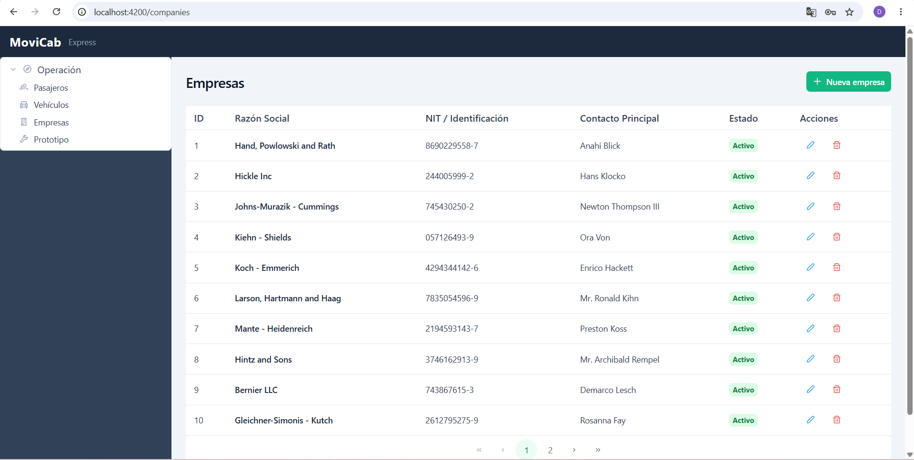

---

#### E.2 — Formulario de Empresa (CompanyForm)
Componente reactivo para creación y edición de empresas con validaciones (`Validators.required`, `Validators.minLength`). En modo edición precarga los datos con `patchValue`. Permite definir el estado reactivo con `p-selectbutton`.

- **Archivos:** `src/app/features/companies/company-form.ts` y `company-form.html`
- **Estado:** ✅ Completado

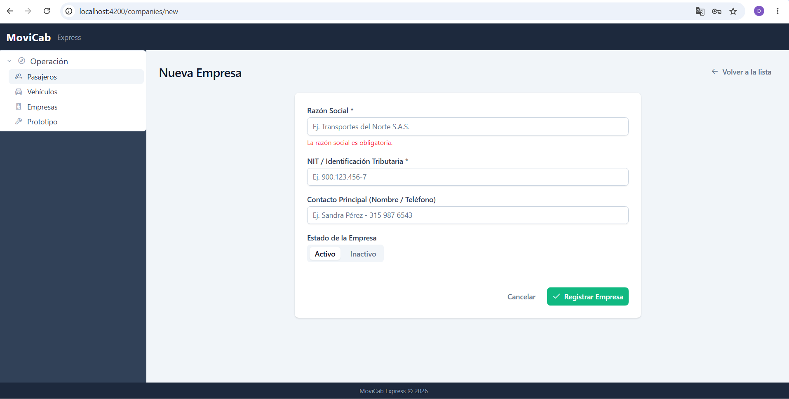

---

#### E.3 — Confirmación Modal y Eliminación de Empresa
Flujo de eliminación con diálogo de confirmación PrimeNG (`ConfirmationService`). Consume `CompanyApi.remove(id)` (`DELETE /api/empresas/:id`). Maneja restricciones de clave foránea cuando la empresa tiene vehículos asociados y actualiza la lista en caso de éxito.

- **Archivos:** `src/app/features/companies/company-list.ts` y `company-list.html`
- **Estado:** ✅ Completado

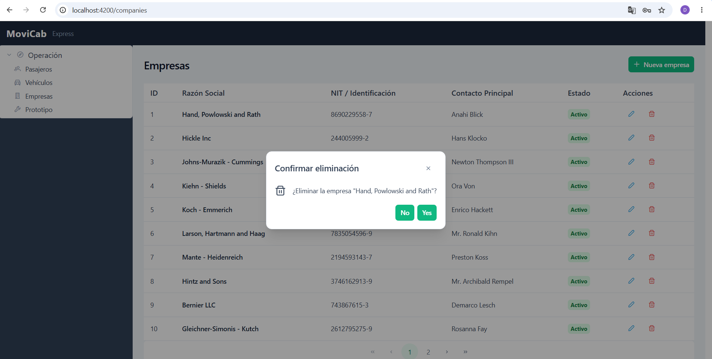


---

## ISS-04C — CRUD de Tipos de Vehículo (VehicleType)

- **Fecha:** 2026-10-31
- **Rama:** `front-movicab-express`
- **Estado:** ✅ Completado
- **Objetivo:** Implementar la gestión completa del catálogo de tipos de vehículo (`/vehicle-types`), incluyendo navegación lateral (`Aside`), tabla con paginación PrimeNG `p-table`, formulario reactivo para alta y edición, y modal de confirmación para eliminación.

---

### Sub-ítems y Evidencias:

#### F.1 — Enrutamiento y Listado de Tipos de Vehículo (VehicleTypeList)
Configuración de rutas `/vehicle-types`, `/vehicle-types/new` y `/vehicle-types/:id/edit` en `app.routes.ts` y enlace "Tipos de Vehículo" (`pi pi-tags`) en `Aside`. Implementación del componente `VehicleTypeList` que consume `VehicleTypeApi.list()` (`GET /api/tipos-vehiculo`), visualizando Nombre y Descripción en tabla paginada.

- **Archivos:** `src/app/app.routes.ts`, `src/app/layout/aside/aside.ts`, `src/app/features/vehicle-types/vehicle-type-list.ts` y `vehicle-type-list.html`
- **Estado:** ✅ Completado

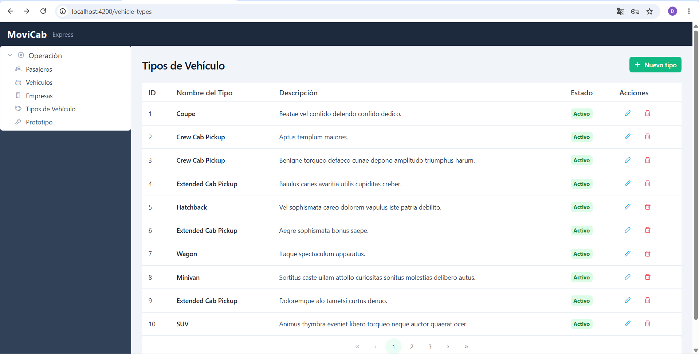

---

#### F.2 — Formulario de Tipo de Vehículo (VehicleTypeForm)
Componente reactivo para creación y edición de tipos de vehículo con validaciones (`Validators.required`). En modo edición precarga los datos mediante `patchValue`. Campos: Nombre (requerido) y Descripción (opcional).

- **Archivos:** `src/app/features/vehicle-types/vehicle-type-form.ts` y `vehicle-type-form.html`
- **Estado:** ✅ Completado

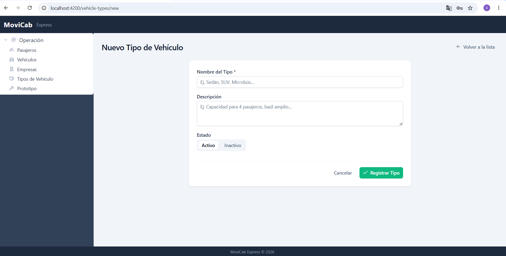

---

#### F.3 — Confirmación Modal y Eliminación de Tipo de Vehículo
Flujo de eliminación con diálogo de confirmación PrimeNG (`ConfirmationService`). Consume `VehicleTypeApi.remove(id)` (`DELETE /api/tipos-vehiculo/:id`). Maneja restricciones de clave foránea cuando el tipo tiene vehículos asociados y refresca la lista en caso de éxito.

- **Archivos:** `src/app/features/vehicle-types/vehicle-type-list.ts` y `vehicle-type-list.html`
- **Estado:** ✅ Completado

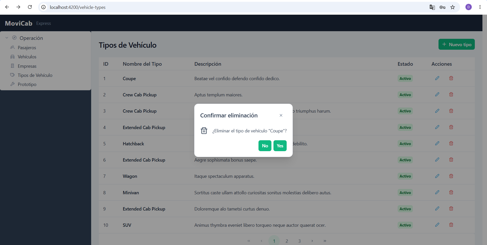

---

## ISS-05 — CRUD de Conductores, Turnos y Tarifas

- **Fecha:** 2026-10-31
- **Rama:** `front-movicab-express`
- **Estado:** ✅ Completado
- **Objetivo:** Implementar los módulos de gestión operativa para Conductores (`/drivers`), Turnos (`/shifts`) y Tarifas (`/fares`), completando la navegación lateral con PrimeNG `PanelMenu`, formularios reactivos con carga concurrente de catálogos foráneos (`forkJoin`), componentes especializados (`p-select`, `p-datepicker`, `p-inputnumber`) y diálogo modal de confirmación para eliminación con manejo de restricciones de integridad referencial.

---

### Sub-ítems y Evidencias:

#### G.1 — Enrutamiento y Listado de Conductores (DriverList)
Configuración de rutas `/drivers`, `/drivers/new` y `/drivers/:id/edit` en `app.routes.ts` y enlace "Conductores" (`pi pi-id-card`) en `Aside`. Implementación del componente `DriverList` que consume `DriverApi.list()` (`GET /api/conductores`), visualizando Nombre, Empresa afiliada (`driver.company?.legal_name`) y Estado con `p-tag`.

- **Archivos:** `src/app/app.routes.ts`, `src/app/layout/aside/aside.ts`, `src/app/features/drivers/driver-list.ts` y `driver-list.html`
- **Estado:** ✅ Completado

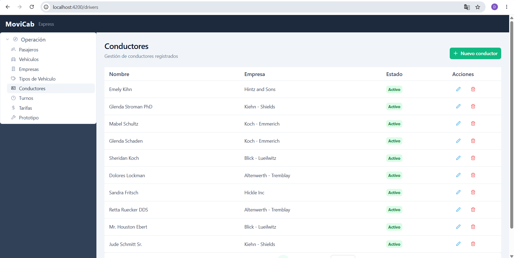

---

#### G.2 — Formulario de Conductor (DriverForm)
Componente reactivo para alta y edición de conductores. Carga el catálogo de empresas mediante `CompanyApi.list()` para alimentar el selector `p-select`. En modo edición precarga los datos con `patchValue`. Permite configurar el estado con `p-selectbutton`.

- **Archivos:** `src/app/features/drivers/driver-form.ts` y `driver-form.html`
- **Estado:** ✅ Completado

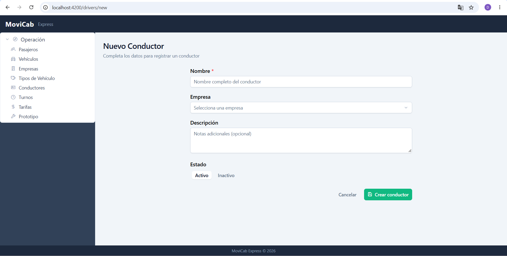

---

#### G.3 — Confirmación Modal y Eliminación de Conductor
Flujo de eliminación conectado con `ConfirmationService`. Invoca `DriverApi.remove(id)` (`DELETE /api/conductores/:id`). Maneja restricciones de clave foránea si el conductor tiene turnos o carreras asignadas y notifica mediante `NotificationService`.

- **Archivos:** `src/app/features/drivers/driver-list.ts` y `driver-list.html`
- **Estado:** ✅ Completado

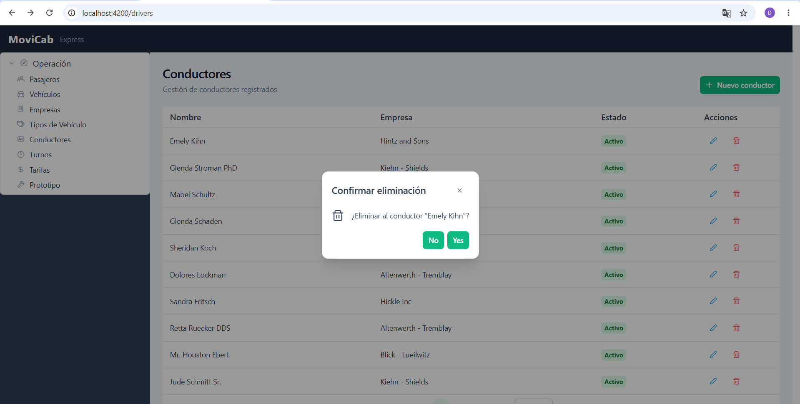

---

#### H.1 — Enrutamiento y Listado de Turnos (ShiftList)
Configuración de rutas `/shifts`, `/shifts/new` y `/shifts/:id/edit` en `app.routes.ts` y enlace "Turnos" (`pi pi-clock`) en `Aside`. Implementación del componente `ShiftList` que consume `ShiftApi.list()` (`GET /api/turnos`), mostrando Nombre del turno, Conductor asignado (`shift.driver?.name`), Vehículo asociado (`shift.vehicle?.name`) y Estado.

- **Archivos:** `src/app/app.routes.ts`, `src/app/layout/aside/aside.ts`, `src/app/features/shifts/shift-list.ts` y `shift-list.html`
- **Estado:** ✅ Completado

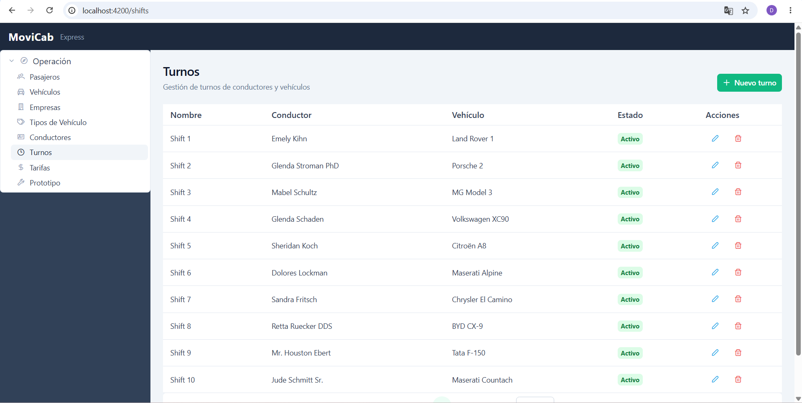

---

#### H.2 — Formulario de Turno con catálogos concurrentes (ShiftForm)
Componente reactivo para asignación de turnos. Utiliza `forkJoin({ drivers: DriverApi.list(), vehicles: VehicleApi.list() })` para poblar los selectores `p-select` de conductor y vehículo de manera concurrente. En modo edición precarga la asignación actual y permite conmutar el estado.

- **Archivos:** `src/app/features/shifts/shift-form.ts` y `shift-form.html`
- **Estado:** ✅ Completado

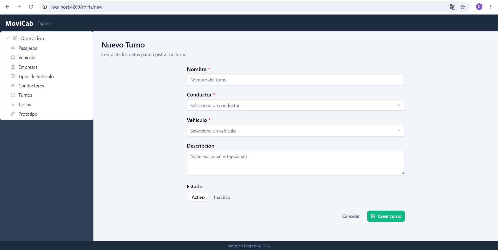

---

#### H.3 — Confirmación Modal y Eliminación de Turno
Flujo de eliminación de turno con confirmación modal. Consume `ShiftApi.remove(id)` (`DELETE /api/turnos/:id`), valida restricciones de integridad referencial si el turno tiene carreras vinculadas y refresca el listado.

- **Archivos:** `src/app/features/shifts/shift-list.ts` y `shift-list.html`
- **Estado:** ✅ Completado

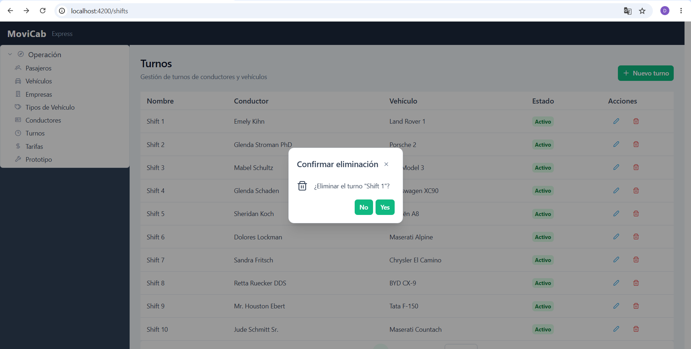

---

#### I.1 — Enrutamiento y Listado de Tarifas (FareList)
Configuración de rutas `/fares`, `/fares/new` y `/fares/:id/edit` en `app.routes.ts` y enlace "Tarifas" (`pi pi-dollar`) en `Aside`. Implementación de `FareList` que consume `FareApi.list()` (`GET /api/tarifas`), formateando el Valor Base mediante `DecimalPipe` y los periodos de vigencia (`valid_from`, `valid_until`) con `DatePipe`.

- **Archivos:** `src/app/app.routes.ts`, `src/app/layout/aside/aside.ts`, `src/app/features/fares/fare-list.ts` y `fare-list.html`
- **Estado:** ✅ Completado


---

#### I.2 — Formulario de Tarifa con controles especializados (FareForm)
Componente reactivo para creación y ajuste de esquemas tarifarios. Incorpora `p-inputnumber` con formato decimal de 2 dígitos para el valor base y `p-datepicker` para selección de rangos de vigencia. Transforma las fechas a formato ISO YYYY-MM-DD y aplica tipado estricto `FarePayload`.

- **Archivos:** `src/app/features/fares/fare-form.ts` y `fare-form.html`
- **Estado:** ✅ Completado


---

#### I.3 — Confirmación Modal y Eliminación de Tarifa
Flujo de eliminación con diálogo PrimeNG `ConfirmationService`. Consume `FareApi.remove(id)` (`DELETE /api/tarifas/:id`), captura restricciones y actualiza reactivamente la tabla de tarifas.

- **Archivos:** `src/app/features/fares/fare-list.ts` y `fare-list.html`
- **Estado:** ✅ Completado


---

## ISS-06 — Carreras (Trip), Pagos (Payment), Calificaciones (Rating) y Liquidaciones (Settlement)

- **Fecha:** 2026-10-31
- **Rama:** `front-movicab-express`
- **Estado:** ✅ Completado
- **Objetivo:** Implementar los flujos operacionales y transaccionales del núcleo de negocio: gestión de carreras con máquina de estados (`solicitada` &rarr; `aceptada` &rarr; `en_curso` &rarr; `cerrada` / `cancelada`), registro de pagos inmutables con validación de carrera cerrada, sistema de calificaciones con estrellas interactivas (`p-rating`) y liquidación periódica consolidada por conductor.

---

### Sub-ítems y Evidencias:

#### J.1 — Enrutamiento y Listado de Carreras (TripList)
Configuración de rutas `/trips` y `/trips/new` en `app.routes.ts` y acceso lateral "Carreras" (`pi pi-compass`) en `Aside`. Implementación de `TripList` que consume `TripApi.list()` (`GET /api/carreras`), mostrando ID, Pasajero asociado, Turno activo, Tarifa contratada, Total liquidado con `DecimalPipe` y Estado operativo con distintivos de severidad PrimeNG (`p-tag`).

- **Archivos:** `src/app/app.routes.ts`, `src/app/layout/aside/aside.ts`, `src/app/features/trips/trip-list.ts` y `trip-list.html`
- **Estado:** ✅ Completado


---

#### J.2 — Formulario de Solicitud de Carrera (TripForm)
Componente reactivo para creación de carreras. Utiliza `forkJoin` para poblar de forma concurrente los catálogos de pasajeros (`PassengerApi`), turnos activos (`ShiftApi`) y tarifas vigentes (`FareApi`). Preselecciona automáticamente la tarifa activa disponible e inicializa la carrera en estado `solicitada`.

- **Archivos:** `src/app/features/trips/trip-form.ts` y `trip-form.html`
- **Estado:** ✅ Completado


---

#### J.3 — Máquina de Estados Operativos (Transiciones de Carrera)
Diálogo modal PrimeNG (`p-dialog`) integrado en el listado para avanzar el ciclo de vida del servicio. Lee las transiciones válidas dictadas por `TRIP_TRANSITIONS` según el estado actual del viaje (`solicitada` &rarr; `aceptada` &rarr; `en_curso` &rarr; `cerrada`), invocando `PATCH /api/carreras/:id/estado`. Al transicionar a `cerrada`, el backend calcula y congela automáticamente el valor total.

- **Archivos:** `src/app/features/trips/trip-list.ts` y `trip-list.html`
- **Estado:** ✅ Completado


---

#### K.1 — Listado de Pagos Recibidos (PaymentList)
Configuración de rutas `/payments` y `/payments/new` en `app.routes.ts` y acceso "Pagos" (`pi pi-wallet`) en el menú lateral. `PaymentList` consume `PaymentApi.list()` (`GET /api/pagos`), desplegando referencia de servicio, método de pago formateado en mayúsculas (`UpperCasePipe`), monto cobrado y fecha de pago.

- **Archivos:** `src/app/app.routes.ts`, `src/app/layout/aside/aside.ts`, `src/app/features/payments/payment-list.ts` y `payment-list.html`
- **Estado:** ✅ Completado


---

#### K.2 — Formulario de Registro de Cobro (PaymentForm)
Formulario inmutable para registro de cobros. Consulta las carreras existentes para seleccionar el viaje a pagar, precargando de manera reactiva el total correspondiente. Incluye selector de métodos de pago (`efectivo`, `tarjeta`, `transferencia`) y control de monto con `p-inputnumber`, respetando la regla del backend que exige que la carrera se encuentre en estado `cerrada`.

- **Archivos:** `src/app/features/payments/payment-form.ts` y `payment-form.html`
- **Estado:** ✅ Completado


---

#### L.1 — Listado de Calificaciones (RatingList)
Configuración de rutas `/ratings` y `/ratings/new` en `app.routes.ts` y acceso "Calificaciones" (`pi pi-star`) en navegación. Implementación de tabla reactiva que consume `RatingApi.list()` (`GET /api/calificaciones`), renderizando la puntuación del viaje mediante componentes de estrellas en modo solo lectura (`p-rating`), junto con el comentario del usuario y fecha de registro.

- **Archivos:** `src/app/app.routes.ts`, `src/app/layout/aside/aside.ts`, `src/app/features/ratings/rating-list.ts` y `rating-list.html`
- **Estado:** ✅ Completado


---

#### L.2 — Formulario de Calificación de Carrera (RatingForm)
Componente reactivo para emisión de valoraciones del servicio de transporte. Permite seleccionar la carrera a evaluar, asignar puntuación de 1 a 5 estrellas mediante `p-rating` y registrar observaciones cualitativas sobre la calidad del viaje.

- **Archivos:** `src/app/features/ratings/rating-form.ts` y `rating-form.html`
- **Estado:** ✅ Completado


---

#### M.1 — Listado de Liquidaciones por Conductor (SettlementList)
Configuración de rutas `/settlements` y `/settlements/new` en `app.routes.ts` y acceso "Liquidaciones" (`pi pi-calculator`) en menú lateral. Consume `SettlementApi.list()` (`GET /api/liquidaciones`) y resuelve el nombre del conductor consultando `DriverApi.list()`, presentando el rango de fechas liquidado, fecha de generación y monto total acumulado.

- **Archivos:** `src/app/app.routes.ts`, `src/app/layout/aside/aside.ts`, `src/app/features/settlements/settlement-list.ts` y `settlement-list.html`
- **Estado:** ✅ Completado


---

#### M.2 — Formulario para Generar Liquidación (SettlementForm)
Formulario reactivo que agrupa las carreras de un conductor en un periodo determinado. Incluye selector de conductores con filtro de búsqueda (`p-select`) y selectores de fecha con calendario PrimeNG (`p-datepicker`) para definir `date_from` y `date_to`. El backend calcula de manera consolidada la suma de los servicios cerrados en el intervalo.

- **Archivos:** `src/app/features/settlements/settlement-form.ts` y `settlement-form.html`
- **Estado:** ✅ Completado


---

## ISS-07 — Detalle de Carrera, Dashboard y Cierre de Fase I

- **Fecha:** 2026-10-31
- **Rama:** `front-movicab-express`
- **Estado:** ✅ Completado
- **Objetivo:** Culminar la Fase I del frontend mediante la construcción del Dashboard ejecutivo y la vista de detalle integrada de carreras. Incluye tarjetas de métricas en tiempo real (volumen de carreras, ingresos recaudados, satisfacción promedio de pasajeros y flota operativa), tablas de actividad reciente con navegación directa, vista unificada de carrera con sus entidades polimórficas asociadas (`Payment` y `Rating`) y redirección de la ruta raíz hacia el Dashboard.

---

### Sub-ítems y Evidencias:

#### N.1 — Dashboard Operativo y Redirección Principal (Dashboard)
Creación del modelo `DashboardStats` en `src/app/core/models/dashboard.model.ts` e implementación de la pantalla `Dashboard` que ejecuta consultas concurrentes mediante `forkJoin` para consolidar indicadores de negocio:
- **Total Carreras:** Desglose interactivo de carreras cerradas vs en curso o solicitadas.
- **Recaudo Pagado:** Suma total de los montos efectivamente cobrados a través de pagos registrados.
- **Satisfacción Pasajeros:** Cálculo del puntaje medio de satisfacción basado en opiniones reales de usuarios con estrellas visuales.
- **Flota Operativa:** Cuantificación de vehículos y conductores activos disponibles en el sistema.
- **Tablas de Actividad:** Tablas con las últimas carreras registradas y los pagos más recientes, con accesos directos al detalle y formularios de alta.
- **Enrutamiento:** Redirección automática de la ruta raíz `/` hacia `/dashboard` y fijación del enlace principal en el menú `Aside` (`pi pi-th-large`).

- **Archivos:** `src/app/core/models/dashboard.model.ts`, `src/app/features/dashboard/dashboard.ts`, `dashboard.html`, `src/app/app.routes.ts` y `src/app/layout/aside/aside.ts`
- **Estado:** ✅ Completado


---

#### N.2 — Vista de Detalle Integral de Carrera (TripDetail)
Implementación de la ruta parametrizada `/trips/:id` en `TripDetail` que coordina la recuperación del viaje y sus entidades asociadas:
- **Servicio de Transporte:** Datos completos del viaje, pasajero, turno asignado, tarifa contratada, estado operativo con `p-tag`, valor total y notas de origen/destino.
- **Gestión de Cobro:** Tarjeta contextual que identifica el registro de pago asociado (`Payment`), detallando comprobante, método de cobro (`efectivo`, `tarjeta`, `transferencia`), monto y fecha, o bien proporcionando el botón de acción para registrar el cobro si el viaje se encuentra cerrado.
- **Calificación del Pasajero:** Tarjeta de valoración que despliega las estrellas (`p-rating`) otorgadas por el cliente, su comentario cualitativo y fecha de registro.
- **Navegación:** Botón de retorno al listado de carreras y modal de cambio de estado operativo sincronizado con `TRIP_TRANSITIONS`.

- **Archivos:** `src/app/features/trips/trip-detail.ts`, `trip-detail.html` y `src/app/app.routes.ts`
- **Estado:** ✅ Completado


---

## ISS-08 — JWT Completo: Refresh Token, Perfil y Permisos RBAC

**Objetivo:** Implementar el ciclo de vida completo de autenticación JWT con rotación automática de refresh tokens, visualización del perfil del usuario autenticado y exposición del catálogo granular de permisos efectivos RBAC. Actualizar el header para mostrar la identidad de sesión activa.

---

### Sub-ítems implementados

#### O.1 — Modelo de Autenticación Ampliado (`auth.model.ts`)
Extensión del modelo de autenticación con tipos dedicados para la sesión completa:
- **`SessionTokens`:** Contrato del par de tokens (`access_token`, `refresh_token`, `expires_in`, `refresh_expires_in`, `token_type`).
- **`ProfileUser`:** Identidad del usuario autenticado obtenida de `GET /api/sesion/perfil` (`id`, `username`, `email`, `avatar`, `status`).
- **`EffectivePermission`:** Permiso granular otorgado por la matriz RBAC (`method`, `path`, `role_name`, `description`).
- **`JwtPayload`:** Estructura del payload decodificado del JWT para inspección client-side.

- **Archivo:** `src/app/core/auth/auth.model.ts`
- **Estado:** ✅ Completado

#### O.2 — Store de Sesión Reactivo (`session.store.ts`)
Reescritura del `SessionStore` como servicio `@Injectable` basado en Signals de Angular:
- Almacena `access_token`, `refresh_token`, `ProfileUser` y `EffectivePermission[]` en `localStorage` con claves prefijadas (`mvc_*`).
- Señales reactivas: `token()`, `refreshToken()`, `user()`, `permissions()`, `isLoggedIn()` (computed).
- Métodos: `saveSession()`, `updateTokens()`, `updateProfile()`, `updatePermissions()`, `clear()`.
- Hidratación desde `localStorage` en la instanciación para mantener sesión entre recargas.

- **Archivo:** `src/app/core/auth/session.store.ts`
- **Estado:** ✅ Completado

#### O.3 — Servicio de Autenticación Completo (`auth.service.ts`)
Implementación del flujo OAuth2-like con:
- **`login()`:** Llama a `POST /api/sesion/login`, guarda temporalmente el `access_token` en el store y ejecuta `forkJoin({profile, permissions})` para obtener datos de sesión de forma concurrente, finalizando con `saveSession()`.
- **`refresh()`:** Solicita un nuevo par de tokens con `POST /api/sesion/refresh` y actualiza el store con `updateTokens()`.
- **`logout()`:** Revoca tokens en el backend con `POST /api/sesion/logout`, limpia el store y redirige a `/login`. Si el endpoint falla, el cliente se limpia igualmente.

- **Archivo:** `src/app/core/auth/auth.service.ts`
- **Estado:** ✅ Completado

#### O.4 — Interceptor HTTP con Refresh Automático (`auth.interceptor.ts`)
Interceptor funcional que gestiona el ciclo de vida de los tokens en cada petición HTTP:
- Inyecta el header `Authorization: Bearer <token>` en todas las solicitudes excepto los endpoints públicos (`/sesion/login`, `/sesion/refresh`, `/sesion/logout`).
- Captura errores `401 Unauthorized`; intenta renovar el token con `AuthService.refresh()` y reintenta la solicitud original con los nuevos tokens.
- Si la renovación falla, invoca `AuthService.logout()` y redirige a `/login`, garantizando que no queden sesiones corruptas.

- **Archivo:** `src/app/core/auth/auth.interceptor.ts`
- **Estado:** ✅ Completado

#### O.5 — Header con Identidad de Sesión (`header.ts` / `header.html`)
Actualización del componente de cabecera para mostrar la sesión activa:
- Muestra el `username` y `email` del usuario autenticado obtenidos de `SessionStore.user()`.
- Botón **"Mi Perfil"** con icono que navega a `/profile`.
- Botón **"Salir"** que invoca `AuthService.logout()` para cerrar sesión de forma segura.

- **Archivos:** `src/app/layout/header/header.ts`, `header.html`
- **Estado:** ✅ Completado

#### O.6 — Vista de Perfil y Permisos Efectivos (`profile.ts` / `profile.html`)
Nuevo componente en la ruta `/profile` que expone la identidad del usuario y su matriz de autorización RBAC:
- **Tarjeta de identidad:** Avatar con inicial generada, `username`, ID, estado de cuenta, correo electrónico y badge de estado JWT con rotación automática.
- **Tabla de permisos:** `p-table` paginada con los `EffectivePermission[]` del store, con badges de color por método HTTP (`GET`→verde, `POST`→azul, `PUT`→naranja, `PATCH`→amarillo, `DELETE`→rojo).
- **Buscador reactivo:** Filtro en tiempo real sobre ruta de recurso y rol otorgante.
- Registra un total de **102 operaciones autorizadas** para el rol `ADMIN`.

- **Archivos:** `src/app/features/profile/profile.ts`, `profile.html`; ruta registrada en `src/app/app.routes.ts`
- **Estado:** ✅ Completado


---

## ISS-09 — Guards, Directiva `*appHasPermission` y Menú Filtrado por RBAC

**Objetivo:** Proteger todas las rutas de la shell con un `AuthGuard` funcional, implementar la directiva estructural `*appHasPermission` que muestra u oculta elementos del DOM según los permisos efectivos del usuario autenticado, y hacer que el menú lateral sea reactivo a la matriz RBAC, mostrando únicamente los ítems para los cuales el rol activo tiene al menos un permiso `GET`.

---

### Sub-ítems implementados

#### P.1 — Guard de Autenticación (`auth.guard.ts`)
Guard funcional `authGuard` que protege el grupo de rutas de la shell:
- Inyecta `SessionStore` y comprueba la señal `isLoggedIn()` en tiempo de navegación.
- Si no hay token activo, retorna `router.createUrlTree(['/login'])` redirigiendo sin disparar la carga del componente.
- Registrado con `canActivate: [authGuard]` en la ruta raíz de la shell en `app.routes.ts`.
- **Verificación:** acceder a `http://localhost:4200` sin sesión redirige automáticamente a `/login`.

- **Archivos:** `src/app/core/auth/auth.guard.ts`, `src/app/app.routes.ts`
- **Estado:** ✅ Completado


#### P.2 — Función utilitaria `hasPermission`
Función pura `hasPermission(permissions, method, path)` en `core/utils/has-permission.ts`:
- Recibe la lista de `EffectivePermission[]` del store, el método HTTP y la ruta del recurso.
- Realiza coincidencia exacta o de prefijo de segmento para cubrir rutas parametrizadas (`/api/pasajeros` cubre `/api/pasajeros/:id`).
- Utilizada tanto por la directiva estructural como por el `Aside` para mantener una única fuente de verdad.

- **Archivo:** `src/app/core/utils/has-permission.ts`
- **Estado:** ✅ Completado

#### P.3 — Directiva Estructural `*appHasPermission`
Directiva `HasPermissionDirective` en `core/directives/has-permission.directive.ts`:
- Acepta un `input.required<string>()` con formato `"MÉTODO /ruta"` (p. ej. `'POST /api/carreras'`, `'DELETE /api/carreras'`).
- Usa un `effect()` reactivo sobre `SessionStore.permissions()`: agrega o elimina la vista embebida del DOM cuando los permisos cambian (p. ej. al cambiar de sesión sin recargar la página).
- Aplicada en `trip-list.html`:
  - `*appHasPermission="'POST /api/carreras'"` → botón **"Nueva carrera"** visible solo con permiso de escritura.
  - `*appHasPermission="'DELETE /api/carreras'"` → botón **🗑 Eliminar** visible solo con permiso de borrado.
- Con rol **DESPACHO** (`seller`): el botón "Eliminar" desaparece del DOM; el botón "Nueva carrera" permanece (tiene `POST /api/carreras` — 26 permisos totales).

- **Archivos:** `src/app/core/directives/has-permission.directive.ts`, `src/app/core/directives/index.ts`
- **Estado:** ✅ Completado

#### P.4 — Menú Lateral Reactivo por Permisos RBAC (`aside.ts`)
Refactorización del componente `Aside` para filtrar ítems de navegación según la matriz RBAC activa:
- Catálogo `ALL_ITEMS` con la propiedad `requiredPermission?: string` por ítem (p. ej. `'GET /api/conductores'`).
- Señal `filteredItems` de tipo `computed<MenuItem[]>()` que reacciona a `SessionStore.permissions()` y reconstruye el árbol del `PanelMenu` en cada cambio de sesión.
- Ítems sin `requiredPermission` (Dashboard, Prototipo) se muestran siempre.
- Con rol **ADMIN**: todos los 12 ítems son visibles (102 permisos efectivos).
- Con rol **DESPACHO**: todos los ítems de negocio se muestran porque el rol tiene `GET` sobre todos los recursos (26 permisos efectivos, todos de lectura y escritura de carreras).

- **Archivos:** `src/app/layout/aside/aside.ts`, `src/app/layout/aside/aside.html`
- **Estado:** ✅ Completado


---

## ISS-10 — Administración RBAC: Usuarios, Roles, Recursos, Asignaciones y Concesiones

**Objetivo:** Implementar la interfaz administrativa de gestión integral para la seguridad y el modelo de control de acceso basado en roles (RBAC). Proporcionar la administración de identidades (usuarios), catálogo de roles, inventario de recursos protegibles de la API, asignación de roles a usuarios y concesión granular de permisos rol-recurso, integrando la visibilidad del módulo al menú lateral según permisos del backend.

---

### Sub-ítems implementados

#### Q.1 — Modelado de Datos y Contratos RBAC (`rbac.model.ts`)
Definición de las entidades y payloads de transferencia para las 5 estructuras de autorización:
- **`User` / `UserPayload`:** Identidad en la base de datos con `username`, `email`, `password`, `avatar` y `status`.
- **`Role` / `RolePayload`:** Agrupador funcional de responsabilidades con `name` (normalizado en mayúsculas), `description` y `status`.
- **`Resource` / `ResourcePayload`:** Punto de acceso protegible definido por el par `(method, path)` con descripción y estado.
- **`RoleUser` / `RoleUserPayload`:** Primer eslabón de la cadena RBAC (relación N:M usuario-rol) con referencias anidadas al usuario y al rol.
- **`ResourceRole` / `ResourceRolePayload`:** Concesión de permiso granular que asocia un recurso a un rol con efecto inmediato.

- **Archivo:** `src/app/core/models/rbac.model.ts`
- **Estado:** ✅ Completado

#### Q.2 — Servicio de Administración de Seguridad (`rbac-api.service.ts`)
Servicio inyectable que interactúa con todos los endpoints de seguridad y autorización del backend Express:
- **Usuarios:** `listUsers()`, `getUser()`, `createUser()`, `updateUser()`, `deactivateUser()`.
- **Roles:** `listRoles()`, `getRole()`, `createRole()`, `updateRole()`, `deactivateRole()`.
- **Recursos API:** `listResources()`, `getResource()`, `createResource()`, `updateResource()`, `deactivateResource()`.
- **Asignaciones de Rol:** `listAssignments()`, `assignRole()`, `deactivateAssignment()` (revocación lógica), `reactivateAssignment()`.
- **Concesiones RBAC:** `listGrants()` (soporta filtros `?role_id=` y `?resource_id=`), `grantResource()`, `deactivateGrant()`, `reactivateGrant()`.

- **Archivo:** `src/app/features/admin/rbac-api.service.ts`
- **Estado:** ✅ Completado

#### Q.3 — Componente Centralizado de Administración RBAC (`rbac-admin.ts` / `rbac-admin.html`)
Implementación de la interfaz de usuario organizada por pestañas de control de acceso:
- **Pestaña Identidades / Usuarios:** Muestra las cuentas registradas (`admin`, `seller`), avatar con iniciales, estado en badge `p-tag`, modal reactivo para creación de nuevos usuarios con validación de fortaleza de clave y botón de acción para desactivar/activar identidades.
- **Pestaña Roles:** Catálogo de roles del sistema (`ADMIN`, `DESPACHO`) con sus descripciones funcionales y diálogo de alta de nuevos roles.
- **Pestaña Recursos API:** Inventario de los 102 endpoints protegidos con badges coloreados por método HTTP (`GET` en verde, `POST` en azul, `PUT`/`PATCH` en naranja, `DELETE` en rojo) y rutas normalizadas por patrón.
- **Pestaña Asignaciones:** Visualización de la vinculación Usuario ↔ Rol con acciones de revocación y reactivación instantánea sin borrado físico.
- **Pestaña Concesiones RBAC:** Matriz completa de 128 permisos concedidos entre roles y recursos, diálogo para otorgar nuevas concesiones y botones para revocar/reactivar permisos en caliente.

- **Archivos:** `src/app/features/admin/rbac-admin.ts`, `rbac-admin.html`
- **Estado:** ✅ Completado

#### Q.4 — Integración en Rutas y Menú RBAC Reactivo
- **Ruta Protegida:** Se registró `/admin/rbac` en `app.routes.ts` bajo la shell autenticada con `canActivate: [authGuard]`.
- **Menú Condicional por RBAC:** En `aside.ts` se configuró la sección **Administración** con la opción **Seguridad y RBAC**, exigiendo el permiso `GET /api/usuarios`. Al iniciar sesión con `admin`, la categoría y el enlace aparecen dinámicamente; al iniciar sesión con `seller` (rol `DESPACHO` sin permisos sobre `/api/usuarios`), la categoría completa permanece oculta.

- **Archivos:** `src/app/app.routes.ts`, `src/app/layout/aside/aside.ts`
- **Estado:** ✅ Completado


